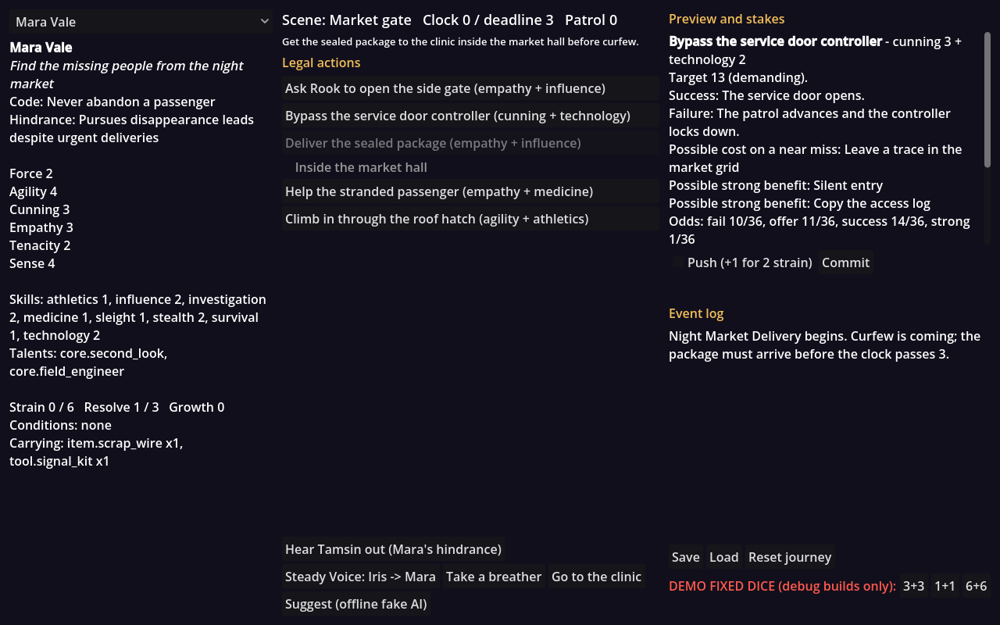

# FACETS — narrative RPG rules for Godot

A deterministic, data-driven character and action-resolution framework for
RPGs, immersive sims, narrative games and AI-driven characters.
**Let AI propose intent. Let FACETS decide outcomes.**

This directory is a self-contained Godot project: the installable addon, its
editor tools, optional AI and combat packages, the *Night Market Delivery*
demo, JSON schemas, conformance fixtures and a headless test suite. It is
independent of the VRM addon in the rest of this repository.



> **Rules source.** The mechanics follow the FACETS implementation brief
> (`docs/implementation-spec-v0.1.md`). The source rules draft it refers to
> (`Game-of-Mods-FACETS.md`) was not available, so `docs/rules-v0.1.md` is a
> placeholder and talent details are recorded as implementation decisions
> marked *pending source* in `docs/decisions.md`. Game of Mods is an intended
> integration, not a conformant implementation.

## Requirements

* **Godot 4.6.3-stable** (the pinned baseline) or **4.7.2-stable** (also
  tested in CI). No other version is claimed — see `docs/compatibility.md`.
* Typed GDScript only: no engine fork, C++ module, GDExtension, mandatory
  autoload or scene tree.

## Layout

| Path | Contents |
|---|---|
| `addons/facets/` | Core rules (`core/`), Resources (`resources/`), JSON/saves (`io/`), editor plugin (`editor/`, `facets_plugin.gd`) and core content (`content/core/`). |
| `addons/facets_ai/` | Optional provider-neutral AI adapter with a deterministic fake provider. |
| `addons/facets_combat/` | Optional zone combat with Bodyguard and Last Reserve. |
| `addons/facets_editor_selftest/` | Development-only editor checks (not shipped). |
| `examples/night_market/` | Playable demo, authored Resources and the walkthrough fixture. |
| `schemas/` | JSON Schemas for characters, actions, packs, requests, AI proposals, events and saves. |
| `tests/` | Headless runner, test cases and language-neutral fixtures. |
| `tools/` | Content generators, parse check, editor self-test, clean-install check, schema check, release builder. |
| `docs/` | API, tutorial, extension guide, decisions, compatibility, save policy, conformance, checklist, milestone report and verification logs. |

## Install / uninstall

Install: copy `addons/facets/` into your project's `addons/` folder (and
optionally `addons/facets_ai/` and/or `addons/facets_combat/`), open the
project, then enable **FACETS** under *Project → Project Settings → Plugins*.
The core runtime also works with the plugin disabled; the plugin only adds the
authoring inspector panels, the validation dock and the odds dock.

Uninstall: disable the plugin, then delete the `addons/facets*` folders. The
plugin never changes project settings, so nothing else needs reverting.
Resources you authored with FACETS scripts will no longer load without them.

## Quick start

```gdscript
var registry := FacetsRegistry.core()
var check := FacetsCheckInput.make(3, 2, 13, true)          # Cunning 3 + Technology 2 vs 13
var evaluation := FacetsResolver.evaluate(check, Vector2i(3, 3), FacetsAdjustments.new())
# total 11, margin -2, provisional costly-success offer; no effects applied
```

For the stateful flow (preview → commit → choices → final event, with saves
and replay) follow `docs/tutorial.md`, then `docs/api.md`.

Run the demo: open this folder in Godot 4.6.3 and press Play
(`examples/night_market/night_market.tscn`). It runs offline with no AI.

## Developer commands

Verified with the official `Godot_v4.6.3-stable_linux.x86_64` and
`Godot_v4.7.2-stable_linux.x86_64` binaries (use one wherever `godot`
appears):

```sh
godot --headless --path . --editor --import                 # import / class cache
godot --headless --path . --script tools/parse_check.gd     # every script compiles
godot --headless --path . --script tests/run_tests.gd       # T01-T30, C01-C04 (exit 1 on failure)
GODOT=godot tools/run_editor_selftest.sh                     # real editor: enable/disable cycles, undo/redo
GODOT=godot tools/verify_clean_install.sh                    # addon in a blank project, plugin off and on
python3 tools/check_schemas.py                               # schemas vs positive/negative fixtures (needs jsonschema)
python3 tools/build_release.py                               # build/*.zip
```

Filter tests with `-- --filter=t08`. The runner fails any test that raises an
engine or script error, and fails the run if any acceptance group has no
tests. CI (`.github/workflows/facets.yml` at the repository root) runs all of
the above on the pinned 4.6.3 binary and the Godot steps again on 4.7.2.

Latest verified results are in `docs/verification/` and summarized in
`docs/milestones.md`.

## Status

Implemented: all of M0–M6 in the brief, with the acceptance groups T01–T30
and C01–C04 covered by automated tests (138 tests). Known limitations — no
source rules document, untested macOS/Windows and exports, no manual editor
UX pass, pending licensing — are listed in `docs/milestones.md` and
`docs/release-checklist.md`.

## License

The rest of this repository is MIT-licensed. For FACETS itself, MIT is the
recommended license subject to the owner's approval before any public
release (see `docs/release-notice.txt`). No third-party assets are bundled.
